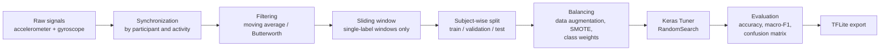

# Human Activity Recognition with Attention-based LSTMs

🇺🇸 English · [🇧🇷 Português](README.pt-BR.md)


Classification of human activities (walking, jogging, climbing stairs, sitting, etc.) from smartwatch and smartphone **accelerometer and gyroscope** signals, using **LSTM networks with an attention mechanism**. The models were evaluated on **5 public datasets**, and the best one was exported to **TensorFlow Lite** to run on the device itself.

_Developed between January and December 2024 (see the [timeline](#timeline) and the commit history). The repository was organized and documented in 2026._

## Highlights

- **95% accuracy and 0.95 macro-F1** on participants the model had never seen (WISDM, smartwatch, 6 activities).
- Attention adds **+4 p.p.** over a plain LSTM, and the sliding window adds **+4 to +10 p.p.**, both measured on the same test set.
- **Subject-wise split**: no person appears in both training and test data, which avoids the data leakage that is common in HAR.
- **Time-series data augmentation**: jittering, rotation and translation, time warping, magnitude scaling, cropping, interpolation between samples, and synthetic transitions.
- **Hyperparameter search** with Keras Tuner (LSTM units, L2 regularization, learning rate, CNN filters, dropout).
- **TFLite export**, with inference validated through `tf.lite.Interpreter`.

## Problem

Recognizing activities from wearable sensors underpins health applications such as elderly monitoring, rehabilitation and sedentary-behavior detection. The main challenges are:

- the signals are noisy and vary a lot from person to person;
- classes are usually imbalanced;
- the model has to be small enough to run on a watch or phone.

This project investigates whether an attention mechanism over the LSTM output, which learns _which moments of the window matter_, improves generalization to new people.

## Datasets

| Dataset | Device / sensors | Classes used | Window / step (samples) |
| --- | --- | --- | --- |
| [WISDM 2019](https://archive.ics.uci.edu/dataset/507/wisdm+smartphone+and+smartwatch+activity+and+biometrics+dataset) | Smartwatch: accelerometer + gyroscope (6 channels), 51 participants | 6 of 18 (walking, jogging, stairs, sitting, playing catch, clapping) | 200 / 20 |
| [UCI-HAPT](https://archive.ics.uci.edu/dataset/341/smartphone+based+recognition+of+human+activities+and+postural+transitions) | Waist-mounted smartphone: accelerometer + gyroscope | 7 | 128 / 16 |
| [KU-HAR](https://data.mendeley.com/datasets/45f952y38r/5) | Smartphone: accelerometer + gyroscope | 5 | 300 / 30 |
| [UniMiB-SHAR](http://www.sal.disco.unimib.it/technologies/unimib-shar/) | Smartphone: accelerometer only (3 channels) | 5 | 151 (pre-segmented samples) |
| [FORTH-TRACE](https://github.com/spl-icsforth/FORTH_TRACE_DATASET) | Wearable sensors: 9 channels | activities + postural transitions | 256 / 25 |

The data is not versioned. See [`Data/README.md`](Data/README.md) to download and organize each dataset.

## Pipeline



## Architectures

**Attention-LSTM** (main model):

```
Input (200 × 6)
  → LSTM (32–256 units, L2 on kernel and recurrent weights, return_sequences=True)
  → Attention: Dense → softmax over time → weighting of the LSTM output → sum
  → Dense (softmax, n_classes)
```

**1D-CNN + 2×LSTM + Self-Attention** (used on UniMiB-SHAR and in the FORTH-TRACE ablations):

```
Input (T × channels)
  → Conv1D (16–256 filters, kernel 3 or 5) → MaxPool → BatchNorm
  → LSTM → LSTM → Dense + Dropout
  → keras.layers.Attention (self-attention) → sum over time
  → Dense (softmax)
```

Baselines compared in [`experiments/`](experiments/): plain LSTM, bidirectional LSTM and ConvLSTM2D.

Training: Adam, categorical cross-entropy, `EarlyStopping` (patience 5, restores the best weights), `ReduceLROnPlateau` and TensorBoard.

## Results

| Dataset | Model | Evaluated on | Accuracy | Macro-F1 |
| --- | --- | --- | --- | --- |
| **WISDM** (6 act.) | **Attention-LSTM + sliding window** | **test**: 5 unseen participants, 511 windows | **0.95** | **0.95** |
| WISDM (6 act.) | Plain LSTM + sliding window | test | 0.91 | 0.91 |
| WISDM (6 act.) | Attention-LSTM, no sliding window | test | 0.91 | 0.91 |
| WISDM (6 act.) | Plain LSTM, no sliding window | test | 0.81 | 0.81 |
| UCI-HAPT (7) | Attention-LSTM + augmentation | validation (held-out participants) | 0.97 | 0.94 |
| KU-HAR (5) | Attention-LSTM + augmentation | validation | 0.92 | 0.92 |
| UniMiB-SHAR (5) | CNN + 2×LSTM + attention + augmentation | validation (held-out participants) | 0.88 | 0.78 |
| FORTH-TRACE | Attention-LSTM | validation (held-out participants) | 0.91 | 0.78 |

Confusion matrix on the WISDM test set. Classes: 0 walking, 1 jogging, 2 stairs, 3 sitting, 4 playing catch, 5 clapping.

<p align="center"></p>

The main error is mistaking _playing catch_ for _walking_ (9 of 85 windows). Both involve arm movement while the body is moving.

**Augmentation ablation on FORTH-TRACE** (CNN + 2×LSTM + attention): applied one at a time, the techniques ranged from 0.67 to 0.88 accuracy, with macro-F1 between 0.38 and 0.68. Rotation and translation helped the minority classes the most, while time warping alone made results worse. The notebooks are in `experiments/har_forth_trace_*_only_*.ipynb`.

## Timeline

Reconstructed from the commit history:

| Period | Stage |
| --- | --- |
| Jan–Feb 2024 | Accelerometer/gyroscope synchronization for WISDM (watch and phone); first LSTMs with Keras Tuner (including the bidirectional one); tests with activity subsets |
| Mar 2024 | Validation by participant groups (k-fold), ConvLSTM and the biometrics experiment |
| Apr 2024 | Final baseline: LSTM on 6 activities, with and without sliding window |
| Sep 2024 | Attention-LSTM (+4 p.p. over the baseline) and TFLite export |
| Nov–Dec 2024 | Generalization to UCI-HAPT, KU-HAR, UniMiB-SHAR and FORTH-TRACE; CNN + 2×LSTM + attention; data augmentation ablation |
| 2026 | Repository organization (`notebooks/` and `experiments/`), output cleanup and documentation |

The original notebooks lived in `Code/DataPrep/`. To follow one of them back to 2024, run `git log --follow notebooks/03_wisdm_attention_lstm.ipynb`.

## Limitations and next steps

To read the results with the right caveats:

- **Only WISDM has an independent test set.** For the other datasets, the numbers come from validation participants that also guided the hyperparameter search, so they are likely optimistic.
- On KU-HAR, the split was done by label, not by participant.
- On WISDM, performance drops to **0.75** with all 18 activities. Hand-oriented activities (eating, writing, typing) are very similar to one another.
- On FORTH-TRACE and UniMiB-SHAR, macro-F1 (0.78) is well below accuracy because of minority classes and transitions.

Next steps:

- subject-wise cross-validation (leave-subjects-out) on every dataset, with a separate test set;
- extract the shared code (windowing, augmentation, models) into a `src/` package with tests;
- measure the latency and size of the TFLite model on a real device.

## How to reproduce

```bash
python -m venv .venv
.venv\Scripts\activate          # Linux/macOS: source .venv/bin/activate
pip install -r requirements.txt
```

1. Download the datasets following [`Data/README.md`](Data/README.md).
2. Start Jupyter **from the `notebooks/` folder**. Paths are relative to the repository root.
3. Run in order: `00` (WISDM preprocessing) → `03` (main model) → `04` (TFLite export). Notebooks `05` to `08` are independent, one per dataset.

The notebooks keep the outputs of the original runs (plots, classification reports and confusion matrices), so the results can be checked without running anything. They were written in Portuguese, so markdown cells and some variable names (e.g. `atividade` = activity, `acelerômetro` = accelerometer, `giroscópio` = gyroscope) are in Portuguese.

## Repository structure

```
├── notebooks/            # main workflow, numbered
│   ├── 00_wisdm_preprocessing.ipynb          syncs smartwatch accelerometer and gyroscope
│   ├── 01_wisdm_exploratory_analysis.ipynb   distributions and signals per activity
│   ├── 02_wisdm_lstm_baseline.ipynb          plain LSTM (baseline)
│   ├── 03_wisdm_attention_lstm.ipynb         main model
│   ├── 04_wisdm_tflite_export.ipynb          TFLite conversion and inference
│   ├── 05_uci_hapt_attention_lstm.ipynb
│   ├── 06_kuhar_attention_lstm.ipynb
│   ├── 07_unimib_shar_cnn_lstm_attention.ipynb
│   └── 08_forth_trace_attention_lstm.ipynb
├── experiments/          # experiment history (see experiments/README.md)
├── Data/README.md        # how to get the data
├── docs/img/             # figures used in this README
└── requirements.txt
```

## Tech stack

Python · TensorFlow/Keras · Keras Tuner · scikit-learn · imbalanced-learn · SciPy · pandas · NumPy · Matplotlib/Seaborn · TensorFlow Lite

## Author

**Cristiano Nascimento**: [LinkedIn](https://www.linkedin.com/in/cristiano-santana-nascimento) · [GitHub](https://github.com/cris33rj)

[MIT](LICENSE) License.
