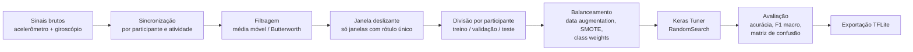
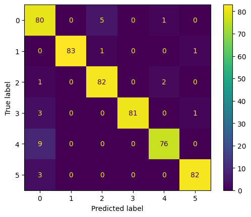

# Reconhecimento de Atividades Humanas com LSTM + Atenção


Classificação de atividades humanas (andar, correr, subir escadas, sentar etc.) a partir de sinais de **acelerômetro e giroscópio** de smartwatch e smartphone, usando redes **LSTM com mecanismo de atenção**. Os modelos foram avaliados em **5 bases públicas** e o melhor foi exportado para **TensorFlow Lite**, para rodar no próprio dispositivo.

_Projeto desenvolvido entre janeiro e dezembro de 2024 (veja a [linha do tempo](#linha-do-tempo) e o histórico de commits). A organização e a documentação do repositório são de 2026._

> **English summary.** Human Activity Recognition (HAR) from wearable accelerometer and gyroscope signals with attention-based LSTMs. Evaluated on 5 public datasets (WISDM, UCI-HAPT, KU-HAR, UniMiB-SHAR, FORTH-TRACE) with subject-wise splits, time-series data augmentation and Keras Tuner hyperparameter search. Best model: **95% accuracy / 0.95 macro-F1 on unseen test subjects** (WISDM smartwatch, 6 activities), exported to TFLite.

## Destaques

- **95% de acurácia e F1 macro de 0,95** em participantes que o modelo nunca viu (WISDM, smartwatch, 6 atividades).
- A atenção acrescenta **+4 p.p.** sobre uma LSTM simples, e a janela deslizante acrescenta **+4 a +10 p.p.**, ambos medidos no mesmo conjunto de teste.
- **Divisão por participante** (_subject-wise_): nenhuma pessoa aparece em treino e teste ao mesmo tempo, o que evita o vazamento de dados comum em HAR.
- **Aumento de dados para séries temporais**: _jittering_, rotação e translação, _time warping_, _magnitude scaling_, _crop_, interpolação entre amostras e transições sintéticas.
- **Busca de hiperparâmetros** com Keras Tuner (unidades LSTM, regularização L2, taxa de aprendizado, filtros da CNN, dropout).
- **Exportação para TFLite** com inferência validada pelo `tf.lite.Interpreter`.

## Problema

Reconhecer atividades a partir de sensores vestíveis é a base de aplicações de saúde, como monitoramento de idosos, reabilitação e detecção de sedentarismo. As principais dificuldades são:

- os sinais são ruidosos e variam muito de pessoa para pessoa;
- as classes costumam ser desbalanceadas;
- o modelo precisa ser leve para rodar no relógio ou no celular.

O projeto investiga se um mecanismo de atenção sobre a saída da LSTM, que aprende _quais instantes da janela importam_, melhora a generalização para pessoas novas.

## Datasets

| Dataset                                                                                                                       | Dispositivo / sensores                                             | Classes usadas                                                     | Janela / passo (amostras)     |
| ----------------------------------------------------------------------------------------------------------------------------- | ------------------------------------------------------------------ | ------------------------------------------------------------------ | ----------------------------- |
| [WISDM 2019](https://archive.ics.uci.edu/dataset/507/wisdm+smartphone+and+smartwatch+activity+and+biometrics+dataset)         | Smartwatch: acelerômetro + giroscópio (6 canais), 51 participantes | 6 de 18 (andar, correr, escadas, sentar, pegar bola, bater palmas) | 200 / 20                      |
| [UCI-HAPT](https://archive.ics.uci.edu/dataset/341/smartphone+based+recognition+of+human+activities+and+postural+transitions) | Smartphone na cintura: acelerômetro + giroscópio                   | 7                                                                  | 128 / 16                      |
| [KU-HAR](https://data.mendeley.com/datasets/45f952y38r/5)                                                                     | Smartphone: acelerômetro + giroscópio                              | 5                                                                  | 300 / 30                      |
| [UniMiB-SHAR](http://www.sal.disco.unimib.it/technologies/unimib-shar/)                                                       | Smartphone: apenas acelerômetro (3 canais)                         | 5                                                                  | 151 (amostras já segmentadas) |
| [FORTH-TRACE](https://github.com/spl-icsforth/FORTH_TRACE_DATASET)                                                            | Sensores vestíveis: 9 canais                                       | atividades + transições posturais                                  | 256 / 25                      |

Os dados não são versionados. Veja [`Data/README.md`](Data/README.md) para baixar e organizar cada base.

## Pipeline



## Arquiteturas

**Attention-LSTM** (modelo principal):

```
Entrada (200 × 6)
  → LSTM (32–256 unidades, L2 no kernel e nos pesos recorrentes, return_sequences=True)
  → Atenção: Dense → softmax ao longo do tempo → ponderação da saída da LSTM → soma
  → Dense (softmax, n_classes)
```

**CNN-1D + 2×LSTM + Self-Attention** (usado em UniMiB-SHAR e nas ablações do FORTH-TRACE):

```
Entrada (T × canais)
  → Conv1D (16–256 filtros, kernel 3 ou 5) → MaxPool → BatchNorm
  → LSTM → LSTM → Dense + Dropout
  → keras.layers.Attention (self-attention) → soma no tempo
  → Dense (softmax)
```

Baselines comparados em [`experiments/`](experiments/): LSTM simples, LSTM bidirecional e ConvLSTM2D.

Treinamento: Adam, entropia cruzada categórica, `EarlyStopping` (paciência 5, restaura os melhores pesos), `ReduceLROnPlateau` e TensorBoard.

## Resultados

| Dataset             | Modelo                                 | Conjunto avaliado                                  | Acurácia | F1 macro |
| ------------------- | -------------------------------------- | -------------------------------------------------- | -------- | -------- |
| **WISDM** (6 ativ.) | **Attention-LSTM + janela deslizante** | **teste**: 5 participantes não vistos, 511 janelas | **0,95** | **0,95** |
| WISDM (6 ativ.)     | LSTM simples + janela deslizante       | teste                                              | 0,91     | 0,91     |
| WISDM (6 ativ.)     | Attention-LSTM, sem janela deslizante  | teste                                              | 0,91     | 0,91     |
| WISDM (6 ativ.)     | LSTM simples, sem janela deslizante    | teste                                              | 0,81     | 0,81     |
| UCI-HAPT (7)        | Attention-LSTM + augmentation          | validação (participantes separados)                | 0,97     | 0,94     |
| KU-HAR (5)          | Attention-LSTM + augmentation          | validação                                          | 0,92     | 0,92     |
| UniMiB-SHAR (5)     | CNN + 2×LSTM + atenção + augmentation  | validação (participantes separados)                | 0,88     | 0,78     |
| FORTH-TRACE         | Attention-LSTM                         | validação (participantes separados)                | 0,91     | 0,78     |

Matriz de confusão no conjunto de teste do WISDM. As classes são 0 andar, 1 correr, 2 escadas, 3 sentar, 4 pegar bola e 5 bater palmas:

<p align="center"></p>

O principal erro é confundir _pegar bola_ com _andar_ (9 de 85 janelas). As duas atividades envolvem deslocamento do braço com o corpo em movimento.

**Ablação de augmentation no FORTH-TRACE** (CNN + 2×LSTM + atenção): aplicadas isoladamente, as técnicas variaram entre 0,67 e 0,88 de acurácia. O F1 macro ficou entre 0,38 e 0,68. Rotação e translação foi a técnica que mais ajudou as classes minoritárias, e _time warping_ sozinho piorou o resultado. Os notebooks estão em `experiments/har_forth_trace_*_only_*.ipynb`.

## Linha do tempo

Reconstruída a partir do histórico de commits:

| Período      | Etapa                                                                                                                                                                      |
| ------------ | -------------------------------------------------------------------------------------------------------------------------------------------------------------------------- |
| jan–fev/2024 | Sincronização de acelerômetro e giroscópio do WISDM (relógio e celular); primeiras LSTMs com Keras Tuner (incluindo a bidirecional); testes com subconjuntos de atividades |
| mar/2024     | Validação por grupos de participantes (k-fold), ConvLSTM e o experimento de biometria                                                                                      |
| abr/2024     | Baseline final: LSTM com 6 atividades, com e sem janela deslizante                                                                                                         |
| set/2024     | Attention-LSTM (+4 p.p. sobre o baseline) e exportação para TFLite                                                                                                         |
| nov–dez/2024 | Generalização para UCI-HAPT, KU-HAR, UniMiB-SHAR e FORTH-TRACE; CNN + 2×LSTM + atenção; ablação de data augmentation                                                       |
| 2026         | Organização do repositório (`notebooks/` e `experiments/`), limpeza das saídas e documentação                                                                              |

Os notebooks originais ficavam em `Code/DataPrep/`. Para ver a evolução de um deles desde 2024, use `git log --follow notebooks/03_wisdm_attention_lstm.ipynb`.

## Limitações e próximos passos

Para ler os resultados com o devido cuidado:

- **Só o WISDM tem conjunto de teste independente.** Nas outras bases, os números vêm de participantes de validação que também guiaram a busca de hiperparâmetros, então tendem a ser otimistas.
- No KU-HAR, a separação foi feita por rótulo, e não por participante.
- No WISDM, o desempenho cai para **0,75** quando se usam as 18 atividades. As atividades com as mãos (comer, escrever, digitar) são muito parecidas entre si.
- No FORTH-TRACE e no UniMiB-SHAR, o F1 macro (0,78) fica bem abaixo da acurácia, por causa das classes minoritárias e das transições.

Próximos passos:

- validação cruzada por participante (_leave-subjects-out_) em todas as bases, com um conjunto de teste separado;
- extrair as funções comuns (janelamento, augmentation, modelos) para um pacote `src/`, com testes;
- medir a latência e o tamanho do modelo TFLite em um dispositivo real.

## Como reproduzir

```bash
python -m venv .venv
.venv\Scripts\activate          # Linux/macOS: source .venv/bin/activate
pip install -r requirements.txt
```

1. Baixe as bases seguindo [`Data/README.md`](Data/README.md).
2. Abra o Jupyter **a partir da pasta `notebooks/`**. Os caminhos são relativos à raiz do repositório.
3. Rode na ordem: `00` (pré-processamento do WISDM) → `03` (modelo principal) → `04` (exportação TFLite). Os notebooks `05` a `08` são independentes, um por base.

Os notebooks foram mantidos com as saídas da execução original: gráficos, relatórios de classificação e matrizes de confusão. Assim é possível ver os resultados sem rodar nada.

## Estrutura do repositório

```
├── notebooks/            # fluxo principal, numerado
│   ├── 00_wisdm_preprocessamento.ipynb      sincroniza acelerômetro e giroscópio do smartwatch
│   ├── 01_wisdm_analise_exploratoria.ipynb  distribuições e sinais por atividade
│   ├── 02_wisdm_lstm_baseline.ipynb         LSTM simples (baseline)
│   ├── 03_wisdm_attention_lstm.ipynb        modelo principal
│   ├── 04_wisdm_exportacao_tflite.ipynb     conversão e inferência TFLite
│   ├── 05_uci_hapt_attention_lstm.ipynb
│   ├── 06_kuhar_attention_lstm.ipynb
│   ├── 07_unimib_shar_cnn_lstm_attention.ipynb
│   └── 08_forth_trace_attention_lstm.ipynb
├── experiments/          # histórico de experimentos (ver experiments/README.md)
├── Data/README.md        # como obter os dados
├── docs/img/             # figuras usadas neste README
└── requirements.txt
```

## Tecnologias

Python · TensorFlow/Keras · Keras Tuner · scikit-learn · imbalanced-learn · SciPy · pandas · NumPy · Matplotlib/Seaborn · TensorFlow Lite

## Autor

**Cristiano Nascimento**: [LinkedIn](https://www.linkedin.com/in/cristiano-santana-nascimento) · [GitHub](https://github.com/cris33rj)

Licença [MIT](LICENSE).
